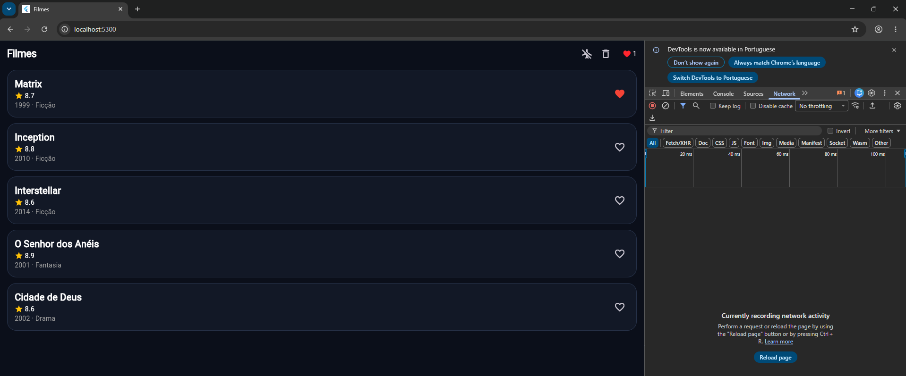
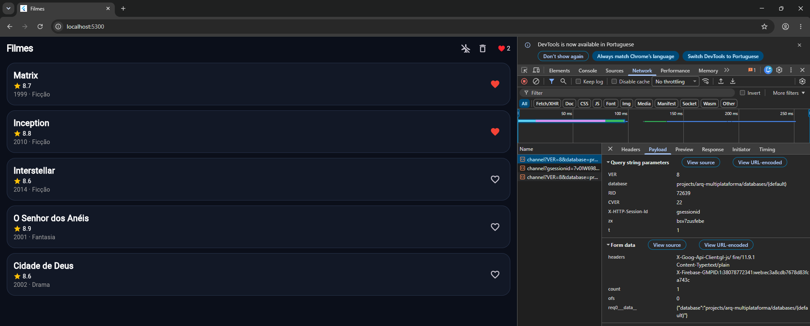
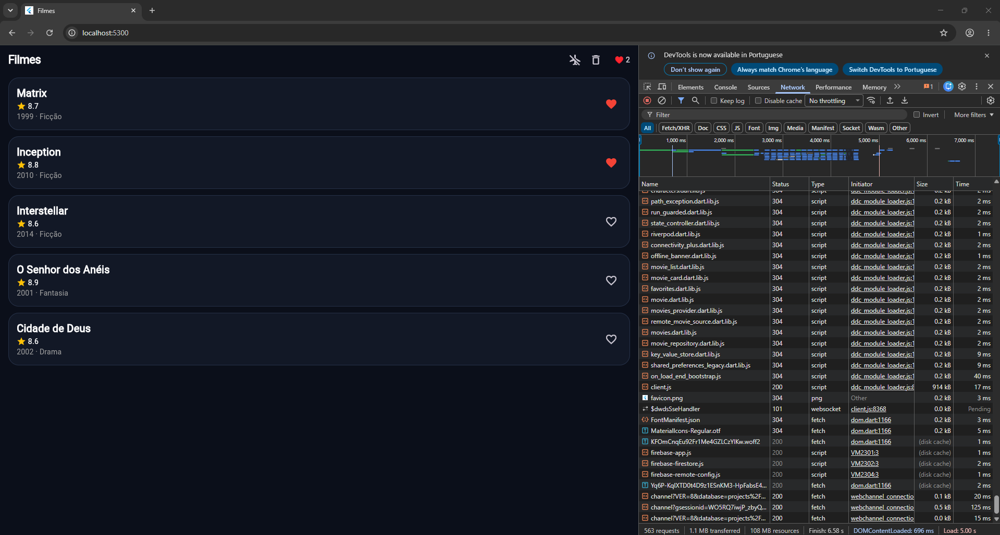
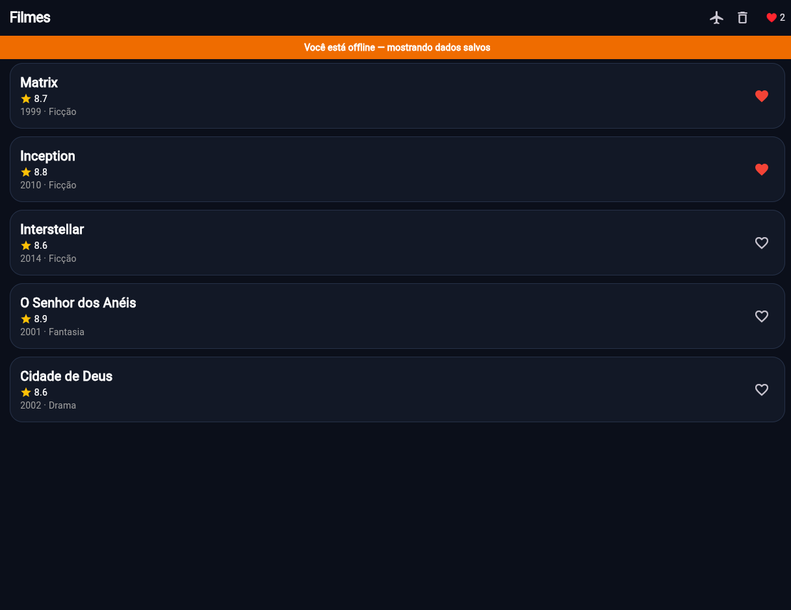

# Filmes (Flutter) — pratica/ da Atividade 3

App de catálogo de filmes em **Flutter**. Já roda; você completa os scaffolds (UI, estado, Firebase e offline-first) até `flutter test` ficar **verde**.

## Rodar

```bash
cd exercicios/03-flutter-ui-estado/pratica   # confirme: ls lib
flutter pub get
flutter run -d chrome --web-port 5300   # PORTA FIXA (o cache offline fica no navegador, por porta)
# 💡 Atalho no VS Code: aperte F5 (o .vscode/launch.json já fixa a porta 5300)
```

## Testar (é o seu checklist)

```bash
flutter test                         # tudo: Ex1–Ex3 (UI/estado) + offline (TASKs 11–15) + checklist
flutter test test/offline_test.dart  # só offline-first — cada grupo = 1 TASK
flutter analyze                      # precisa ficar limpo
```

Comece com os testes **vermelhos**; deixe-os **verdes**. `test/checklist_test.dart` e `test/offline_test.dart` são a **spec** (não edite).

## O que completar (🧑‍🏫 aula · 🧑‍💻 casa)

| TASK | Arquivo                                  | O quê                                          |               |
| ---- | ---------------------------------------- | ---------------------------------------------- | ------------- |
| 1    | `lib/widgets/movie_card.dart`            | compor o card (título + ⭐ nota + ano)         | 🧑‍🏫            |
| 2    | `lib/state/favorites.dart`               | `favoritesProvider` (`toggle` + `clear`)       | 🧑‍🏫            |
| 3    | `lib/main.dart`                          | projeto Firebase + `flutterfire configure`     | 🧑‍🏫            |
| 10   | `lib/main.dart`                          | persistência offline do Firestore (1 linha)    | 🧑‍🏫 fácil      |
| 4    | `lib/widgets/movie_card.dart`            | coração favoritando (`ConsumerWidget` + `ref`) | 🧑‍💻            |
| 5    | `lib/screens/home_screen.dart`           | contador `♥ N` no header                       | 🧑‍💻            |
| 6    | `lib/screens/home_screen.dart`           | botão **limpar** favoritos                     | 🧑‍💻            |
| 7    | `lib/state/favorites.dart`               | persistir favoritos no **Firestore**           | 🧑‍💻 médio      |
| 8    | `lib/services/remote_config.dart` + home | banner via **Remote Config**                   | 🧑‍💻 médio      |
| 9    | `test/favorites_test.dart`               | **você escreve** um teste do provider          | 🧑‍💻            |
| 11   | `lib/widgets/offline_banner.dart`        | aviso "você está offline"                      | 🧑‍💻 fácil      |
| 12   | `lib/models/movie.dart`                  | `toJson` / `fromJson`                          | 🧑‍💻 fácil      |
| 13   | `lib/data/movie_repository.dart`         | repositório **cache-first**                    | 🧑‍💻 médio      |
| 14   | `lib/data/movie_repository.dart`         | validade do cache (**TTL**)                    | 🧑‍💻 médio      |
| 15   | `lib/data/sync_queue.dart`               | **fila de sincronização** (conflitos + flush)  | 🧑‍💻 🔴 difícil |

✈️ O botão de **avião** na barra do topo simula o modo offline. Veja o `guia-passo-a-passo.md` e o `enunciado.md` (rubrica).

## Entrega

Fork + PR no repo público; link no Canvas. O **J.A.R.V.I.S.** lê o seu código (estrutural) e posta uma nota **mínima**; a final sai no Canvas.

- ✏️ **Edite os arquivos dentro de `exercicios/03-flutter-ui-estado/pratica/` (no lugar)** — **não crie subpasta** `aluno-.../`.

> **CI no seu fork (opcional):** habilite o _Actions_ do fork — o workflow _Flutter test — Atividade 3_ roda `flutter analyze` + `flutter test` a cada push.
> **Versões:** precisa de Flutter **3.27+** (o `pubspec` já avisa se for mais antigo).

> **Não comite** `.dart_tool/`, `build/`, `pubspec.lock` (já no `.gitignore`).

---

## Como rodar (resumo)

1. Preencha `lib/firebase_options.dart` com o seu projeto Firebase (`flutterfire configure` ou Plano B do enunciado) e crie o Firestore com as regras do enunciado.
2. `flutter pub get` → `flutter run -d chrome --web-port 5300` → `flutter test` → `flutter analyze`.

## Local vs cloud vs offline-first (trade-offs)

Estado **local** (o `Set<int>` do Riverpod) é instantâneo e funciona sem rede, mas vive só na memória do aparelho: um F5 e os favoritos somem, e nada é compartilhado entre dispositivos. O estado em **cloud** (Firestore) resolve isso — persiste e sincroniza entre abas e aparelhos — mas depende de rede, adiciona latência e exige regras de segurança e projeto configurado; sem conexão, a leitura/gravação falha. A arquitetura **offline-first** junta o melhor dos dois: a UI sempre lê primeiro o que está no aparelho (cache com TTL), atualiza em segundo plano quando há rede e enfileira as escritas feitas offline (fila com resolução de conflitos), enviando-as na volta da conexão. O custo é a complexidade: é preciso decidir validade de cache, serialização, conflitos (favoritar + desfavoritar se cancelam) e o que fazer se a rede cair no meio do envio.

## Provas

**Ex4 (Firestore): favoritos sobrevivem ao F5**

1. Antes de qualquer ação (nenhum filme favoritado):

   

2. Depois de favoritar, o payload da gravação visto no F12:

   

3. Depois do F5, o favorito continua lá:

   

- **Offline:** _print do app em modo avião (banner + lista)._


