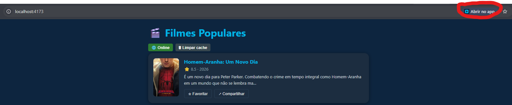
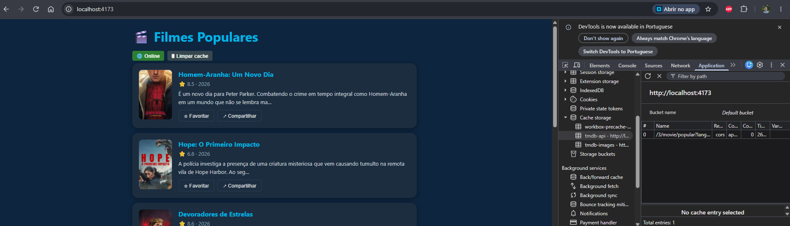
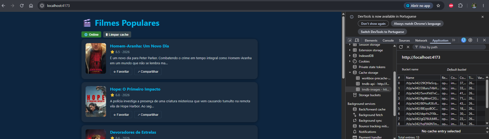
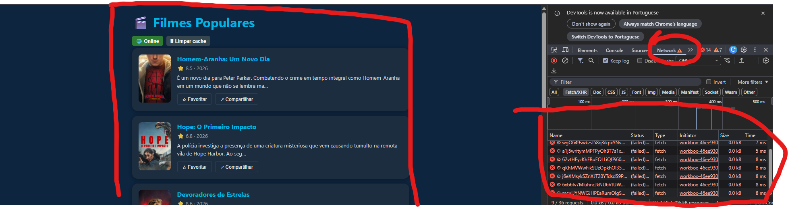

# ENTREGA — Atividade 4 (PWA: filmes populares, instalável e offline)

**Aluno:** Gabriel Santiago Silva
**GitHub:** <seu-login>
**Disciplina:** Arquitetura de Aplicações Móveis e Multiplataforma

> Como usar: salve cada print na pasta `prints/` com o nome indicado e apague os comentários `<!-- -->` quando terminar.

---

## 1. Site comum × PWA

Comparei `https://pwa-tmdb-aula4.vercel.app` com um site comum (modo avião, fechar e reabrir, instalar).

### Diferença 1 — Funciona sem rede (modo avião)

<!-- Print: site comum em offline (dinossauro / erro) E o PWA em offline carregando normalmente -->

**Site comum:** _descreva o que aconteceu_
**PWA:** _descreva o que aconteceu_

### Diferença 2 — Fechar e reabrir

<!-- Print: DevTools → Application → Service Workers (status "activated and is running") -->

**Site comum:** _descreva_
**PWA:** _descreva_

### Diferença 3 — Instalação

<!-- Print: ícone de instalar na barra de endereço OU o app aberto em janela standalone -->

**Site comum:** _descreva_
**PWA:** _descreva_

---

## 2. Prova do offline

Build de produção (`npm run build && npm run preview`, em `http://localhost:4173`), pois o SW não roda no `npm run dev`.

### Cache Storage

<!-- Print: DevTools → Application → Cache Storage → tmdb-api (com itens) e tmdb-images (com itens). Dois prints, um de cada. -->

### App em modo avião

<!-- Print: DevTools → Network → Offline (ou modo avião real), app com filmes + pôsteres na tela -->

### Aviso de atualização (TODO 3)

<!-- Print 1: "App pronto para uso offline" na 1ª visita. Print 2: "Nova versão disponível" com Atualizar/Depois -->

---

## 3. Reflexão — `autoUpdate` × `prompt`

Com `autoUpdate`, o Service Worker novo assume sozinho e a página recarrega sem o usuário decidir nada. Com `prompt`, o SW novo fica em espera até o usuário clicar em "Atualizar".

Para um app de **checkout**, escolheria `prompt`. Um reload automático no meio de um pagamento pode apagar o estado do carrinho ou interromper a transação, e a versão antiga e a nova podem ter contratos de API incompatíveis no meio do fluxo. Deixar o usuário atualizar quando terminar a compra evita isso.

Para um app de **notícias**, escolheria `autoUpdate`. Não há estado crítico a proteger, o conteúdo é a parte que mais muda e o usuário quer sempre a versão mais recente sem ser interrompido por um aviso.

O trade-off é controle do usuário (`prompt`) contra garantia de que todos rodam a versão mais nova (`autoUpdate`).
